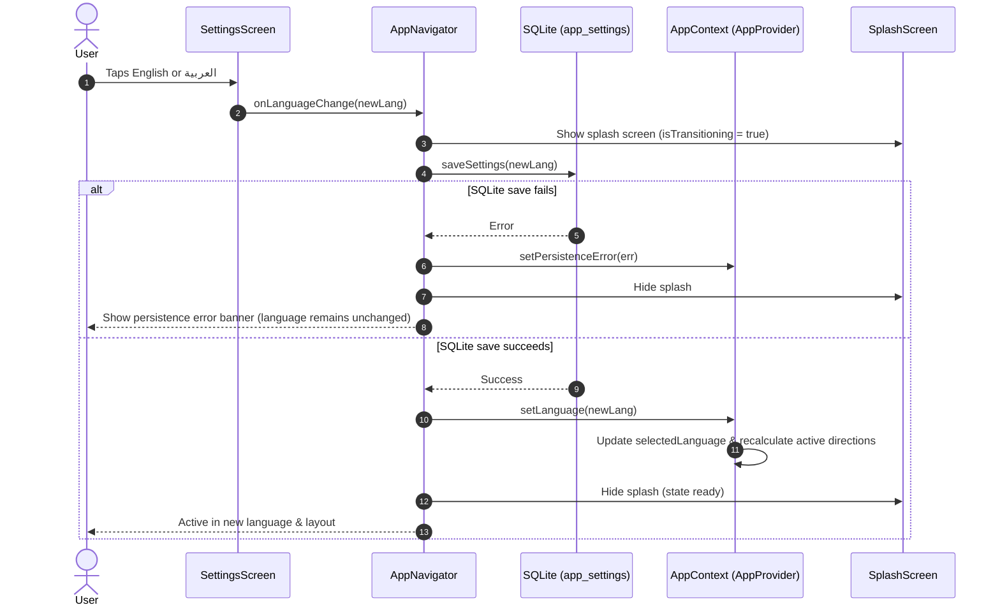

# Qooti — Phase 1, Task 10B: Requirements & Architecture Revision (Corrected)
**In-App Language Switcher Architecture for iOS and Android**

- **Document Version:** 2.0.0
- **Status:** APPROVED WITH MANDATORY ARCHITECTURE CORRECTIONS
- **Target Branch:** `upgrade/expo-sdk-58`
- **Target Platforms:** iOS & Android (Expo SDK 58 / React Native)

---

## 1. Previous Architecture and Reason for Cancellation

### Previous Architecture (Task 10B Initial Implementation)
In the initial Task 10B implementation, language switching on iOS was decoupled from Android:
1. **iOS Authority:** Apple's native per-app language was designated as the sole authority on iOS via `expo-localization`'s `getLocales()`.
2. **Settings Lockout:** On iOS, in-app language switching in `SettingsScreen.tsx` was disabled. Instead, users were shown a notice and a button that executed `Linking.openSettings()` to redirect users to Apple's system Settings (`Settings -> Qooti -> Preferred Language`).
3. **Lifecycle Hijack:** An `AppState` listener in `AppContext.tsx` automatically re-queried `getLocales()` whenever the app returned to foreground, overriding any in-app stored language state.
4. **Android Legacy Prompt:** On Android, in-app switching displayed a disruptive `Alert.alert` ("Restart Required" / "إعادة التشغيل") asking the user to restart the application.

### Reason for Cancellation
The user has **explicitly rejected** the iOS Settings redirect approach for the following reasons:
- **Disruptive User Experience:** Forcing users to leave the app, navigate iOS system settings, change language, and return creates severe friction in a fitness app.
- **Expo Go & Dev Build Incompatibility:** In Expo Go and internal development builds, the iOS per-app language bundle plist is often absent or inaccessible in system Settings, leaving users with no way to change language.
- **Disparate Platform Behavior:** Creating different language switching UX between iOS and Android introduced unnecessary complexity and inconsistent test protocols.
- **Disruptive Restart Dialogs:** Asking the user to confirm a restart dialog or manually kill the app is antiquated and degrades the user experience.

---

## 2. Mandatory Architecture Corrections

The revision incorporates the following 12 mandatory rules:

1. **NO `I18nManager.forceRTL()` or `allowRTL()` During Normal Switching:**
   - Do NOT call `I18nManager.forceRTL()` or `allowRTL()` during normal language switching merely to prepare a future boot.
2. **NO `DevSettings.reload()`:**
   - Do NOT use `DevSettings.reload()` or any native runtime restart in the language-selection flow.
3. **Language-Aware React Layout Direction:**
   - Implement language-aware React layout direction using the selected language and existing RTL utilities (`rowStyle`, `textAlign`, `writingDirection`, `direction`).
4. **Avoid Double Mirroring:**
   - Avoid double mirroring when native `I18nManager.isRTL` differs from the selected application language using `shouldReverseLayout(lang)` (`isRTL(lang) !== I18nManager.isRTL`).
5. **Acknowledge Native UIKit Limits Honestly:**
   - Do not assume remounting the React tree guarantees full native UIKit direction changes. Native OS chrome (such as native alert sheets or OS keyboard menus) remains bound to the native OS environment until cold restart.
6. **State-Driven SplashScreen (No Arbitrary Timer):**
   - Use the existing `SplashScreen` during initialization and language switching. Do not impose an arbitrary 600ms delay as the definition of success. Dismiss the splash screen when required state is ready (with an optional short minimum display duration for visual polish).
7. **SQLite Save Must Complete First:**
   - Complete the SQLite language save *before* switching the authoritative language in state or updating the UI. If the write fails, abort the switch, surface the persistence error banner, and leave the current language active.
8. **Preserve Unsaved Forms & In-Flight Writes:**
   - Prevent language switching from discarding unsaved forms or interrupting in-flight database writes. Do not reset or unmount application-level repositories or store queues.
9. **Non-Destructive AppContext:**
   - Ensure `AppContext` (`AppProvider`) is NEVER destructively remounted or unmounted during language switching. Preserving `AppProvider` in place ensures sample data is never reseeded and existing in-memory state is maintained.
10. **Physical iPhone Verification:**
    - Verify real Arabic translations and RTL alignment on the physical iPhone, not only through mocked tests.
11. **Comprehensive Test Suite:**
    - Keep all 77 existing tests passing and add tests for the revised language-switching behavior.
12. **Living Documentation:**
    - Update documentation to reflect these architectural guarantees.

---

## 3. Approved User Experience

The approved architecture standardizes an **instant in-app language switcher** across **both iOS and Android**:

1. **User Navigation:** The user opens Qooti and navigates to **Settings → Language**.
2. **Direct Selection:** The user sees interactive selection cards for **English** and **العربية** on both iOS and Android.
3. **Seamless Transition:**
   - The user taps the desired language.
   - The app verifies no in-flight write conflict, then commits the preference to SQLite (`saveSettings`).
   - The app briefly shows `<SplashScreen />` while the new language state and directional styles commit to React state.
   - The splash screen dismisses as soon as the state is ready.
   - The user continues using Qooti in the selected language.
4. **Layout Direction:**
   - English renders in Left-to-Right (LTR).
   - Arabic renders in Right-to-Left (RTL) with proper Arabic text alignment, card mirroring, and back navigation.
5. **Zero Friction:**
   - **NO** redirect to iPhone Settings (`Linking.openSettings()` removed).
   - **NO** restart confirmation dialog (`Alert.alert` removed).
   - **NO** manual closing or reopening required.
   - **NO** native process reload crashes.

---

## 4. Files Requiring Modification

| File | Current Role | Required Changes |
| :--- | :--- | :--- |
| **`src/services/localizationService.ts`** | Delegates iOS to `getLocales()`, provides `openIosAppSettings()` | Make SQLite stored language authoritative for **both** iOS and Android. Retain `getNativeDeviceLanguage()` only as initial default on first install when SQLite has no stored preference. Remove `openIosAppSettings()`. |
| **`src/utils/rtl.ts`** | Calls `I18nManager.forceRTL()` in `applyRTL()` | Remove `I18nManager.forceRTL()`, `allowRTL()`, and `swapLeftAndRightInRTL()` from `applyRTL()` / `setActiveLanguage()`. Ensure React layout styles rely entirely on dynamic style calculation and `shouldReverseLayout`. |
| **`src/utils/languageDirection.ts`** | Delegates to `rtl.ts` | Ensure `applyAppDirection` does not invoke `I18nManager` native setters. |
| **`src/screens/SettingsScreen.tsx`** | Shows iOS settings button if `Platform.OS === 'ios'` | Remove `Platform.OS === 'ios'` check. Render interactive radio selection cards (`English` / `العربية`) uniformly on both iOS and Android. |
| **`src/store/AppContext.tsx`** | Contains `AppState` listener overriding iOS language | Remove `AppState` listener that hijacked language. Ensure `AppProvider` stays mounted at root. Ensure SQLite write completes before state update. |
| **`src/navigation/AppNavigator.tsx`** | Calls `Alert.alert` on language change | Remove `Alert.alert` restart prompt in `changeLanguage`. Coordinate splash screen visibility based on readiness, not arbitrary timer. |
| **`src/i18n/en.json` & `ar.json`** | Contains `iosLanguageNotice`, `openSettings...` keys | Clean up obsolete iOS settings notice strings. Retain full parity on all other UI translation keys. |
| **`src/__tests__/nativeLocalization.test.ts`** | Tests iOS system settings precedence & `openIosAppSettings` | Update test suite to assert uniform SQLite authority across iOS and Android, and test in-app reinitialization. |
| **`src/__tests__/rtlLanguage.test.ts`** | Asserts restart alert is triggered on language switch | Update regression tests to verify language switch succeeds without `Alert.alert` or reload loops. |
| **`docs/native-smoke-test-protocol.md`** | Specifies manual alert verification in Section 8 | Update manual protocol to reflect in-app switching and splash reinitialization. |

---

## 5. Architecture and State-Transition Design

### Key Architectural Safeguards
1. **AppProvider Permanence:** `AppProvider` remains mounted at the root of the app. It is NEVER destroyed or remounted during language switching. This guarantees:
   - Hydration runs strictly once on cold boot.
   - Sample data is NEVER re-seeded.
   - In-flight meal and workout saves are never interrupted.
2. **SQLite-First Gate:** The database write to `app_settings` completes *prior* to updating the React context language. If disk write fails, the UI does not switch into an inconsistent state.
3. **No I18nManager Side-Effects:** No calls to `I18nManager.forceRTL()` during language switching. Layout is driven purely by React styles:
   - `direction`: `'rtl'` | `'ltr'`
   - `flexDirection`: `rowDirection(lang)`
   - `textAlign`: `textAlign(lang)`
   - `writingDirection`: `writingDirection(lang)`

---

## 6. Native RTL Limitations (Honest Disclosure)

1. **Native UIKit Containers vs. React Views:**
   - React Native components (`View`, `Text`, `ScrollView`, `Pressable`, custom cards, bottom tabs, headers) adhere 100% to Yoga flex styles and render with full RTL alignment.
   - However, OS-level native alerts (`Alert.alert`), system keyboards, and native OS modal presentation gestures remain bound to the native process locale and do NOT dynamically mirror without a cold restart of the app process.
2. **Expo Go Limitations:**
   - In Expo Go on iOS, native process reboot is impossible without crashing. Using pure React layout direction is the only stable mechanism for seamless in-app switching.

---

## 7. Automated Acceptance Criteria

1. **Uniform Cross-Platform SQLite Authority:**
   - On iOS, when SQLite has `'ar'`, `resolveAuthoritativeLanguage('ar')` returns `'ar'`.
   - On Android, when SQLite has `'en'`, `resolveAuthoritativeLanguage('en')` returns `'en'`.
   - When SQLite has `null` (clean install), it falls back to `getNativeDeviceLanguage()`.
2. **No `I18nManager.forceRTL()` Calls on Switch:**
   - Verify that switching language in-app does not invoke `I18nManager.forceRTL()`.
3. **Zero Restart Dialogs or Crashes:**
   - `changeLanguage` executes without `Alert.alert`, `DevSettings.reload`, or unhandled promise rejections.
4. **Data Preservation:**
   - Meals, workouts, profile, and theme remain intact in SQLite and memory across switches.
   - Onboarding state is preserved.
5. **Test Suite:**
   - All 77 existing tests pass, plus new tests covering the revised language switching behavior.

---

## 8. Physical iPhone Validation Checklist

- [ ] 1. Open Qooti in Expo Go / Dev Client on physical iPhone.
- [ ] 2. Navigate to **Settings → Language**.
- [ ] 3. Tap **العربية** directly in-app.
- [ ] 4. Confirm NO alert popup appears, NO redirect to iPhone Settings occurs.
- [ ] 5. Confirm Splash screen displays briefly and dismisses once ready.
- [ ] 6. Confirm Arabic translations display across screens.
- [ ] 7. Confirm Arabic layout aligns properly (headers, cards, bottom navigation).
- [ ] 8. Navigate to Meals/Workouts and confirm user data is intact.
- [ ] 9. Switch back to **English** -> Confirm smooth LTR restoration.
- [ ] 10. Force close and reopen -> Confirm selected language persists.
